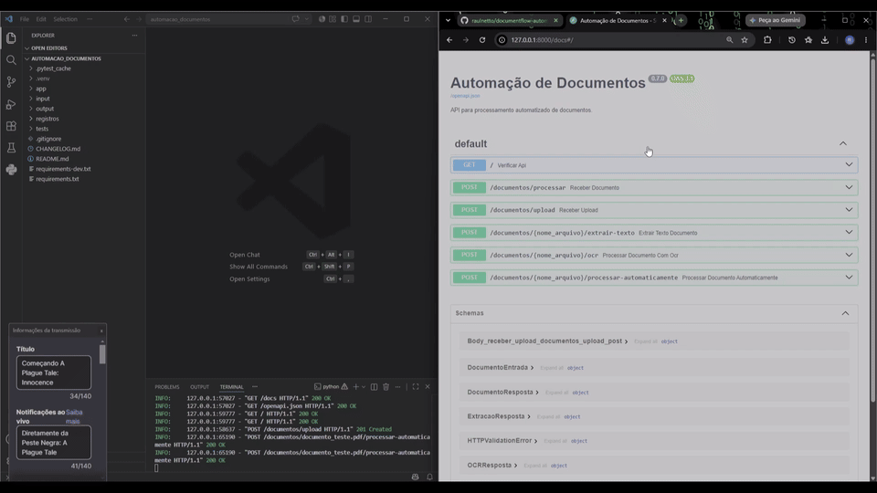

# DocumentFlow Automation

[](https://github.com/raulnetto/documentflow-automation/actions/workflows/tests.yml)

API FastAPI para validar e processar documentos PDF e imagens. Extrai texto de PDFs digitais com PyMuPDF, usa Tesseract OCR para imagens e PDFs digitalizados, grava saídas em texto e mantém histórico em JSON e SQL. SQLite é o backend padrão; PostgreSQL é opcional via `DATABASE_URL`.

## Versão

Versão preparada: **v0.11.0**. O endpoint raiz e o metadata OpenAPI anunciam `0.11.0`.

## Funcionalidades

- Upload e validação de PDF, PNG e JPEG.
- Extração de PDF, OCR e seleção automática do mecanismo.
- Histórico com UUID, metadados de origem e fluxo, e resumo agregado.
- Persistência SQLite por padrão ou PostgreSQL via SQLAlchemy Core e Psycopg.
- Workflow N8N exportável em `n8n/workflows/documentflow-processamento.json`.
- Execução local com Python ou API e PostgreSQL via Docker Compose.

## Arquitetura e processamento

FastAPI → services → repository → SQLite (padrão) ou PostgreSQL; os registros também são gravados como JSON em `registros/`. O repository usa SQL parametrizado. A tabela `processamentos` usa o UUID como chave primária. O histórico contém data/hora, arquivo, origem, fluxo, status, mecanismo, saída, quantidades de páginas/caracteres e mensagem de erro. O processamento automático usa PyMuPDF para PDF com texto digital, Tesseract como fallback para PDF sem texto e diretamente para imagens. Saídas TXT ficam em `output/`.

## Pré-requisitos

- Git.
- Python 3.14 para execução local e testes.
- Tesseract OCR para processamento local de imagens e PDFs digitalizados. No Windows, instale o executável e configure `TESSERACT_CMD` se ele não estiver no `PATH`. A imagem Docker instala Tesseract e o idioma português.
- Docker Desktop com Docker Compose para executar o perfil PostgreSQL containerizado.

## Primeira instalação em um clone

Clone o repositório e abra sua pasta:

```powershell
git clone https://github.com/raulnetto/documentflow-automation.git
Set-Location documentflow-automation
```

Crie e ative um ambiente virtual e instale as dependências de desenvolvimento:

```powershell
py -3.14 -m venv .venv
.\.venv\Scripts\Activate.ps1
python -m pip install --upgrade pip
python -m pip install -r requirements-dev.txt
```

Para OCR local no Windows, configure o caminho do executável nesta sessão do PowerShell, ajustando-o à instalação:

```powershell
$env:TESSERACT_CMD = 'C:\Program Files\Tesseract-OCR\tesseract.exe'
```

O serviço cria a estrutura SQL automaticamente na primeira utilização. Sem `DATABASE_URL`, usa `dados/documentflow.db`; documentos, saídas e registros JSON locais ficam em `input/`, `output/` e `registros/`. Esses dados locais são ignorados pelo Git.

## Executar localmente com SQLite

Não defina `DATABASE_URL` para usar SQLite. Inicie a API:

```powershell
python -m uvicorn app.main:app --reload
```

Abra `http://127.0.0.1:8000/docs` para explorar a API. Alguns endpoints principais:

| Método | Rota | Ação |
| --- | --- | --- |
| Método | Rota | Ação e respostas principais |
| --- | --- | --- |
| `GET` | `/` | Estado e versão da API (`200`) |
| `POST` | `/documentos/processar` | Valida metadados (`202`, `400`) |
| `POST` | `/documentos/upload` | Armazena upload (`201`, `400`) |
| `POST` | `/documentos/{nome_arquivo}/extrair-texto` | Extrai PDF (`200`, `400`, `404`) |
| `POST` | `/documentos/{nome_arquivo}/ocr` | Executa OCR (`200`, `400`, `404`, `503`) |
| `POST` | `/documentos/{nome_arquivo}/processar-automaticamente` | Escolhe extração/OCR e registra resultado (`200`, `400`, `404`, `503`) |
| `POST` | `/webhooks/processar-documento` | Processa arquivo pelo nome (`200`, `400`, `404`, `503`) |
| `GET` | `/processamentos` | Lista o histórico (`200`) |
| `GET` | `/processamentos/{identificador}` | Recupera registro por UUID (`200`, `404`) |
| `GET` | `/processamentos/resumo` | Retorna resumo agregado (`200`) |

Exemplo de entrada do webhook:

```json
{
  "nome_arquivo": "documento_demo.pdf",
  "origem": "n8n",
  "id_fluxo": "workflow-001"
}
```

Uma resposta `200` inclui `status`, `origem`, `id_fluxo`, nome dos arquivos, mecanismo, `id_registro` e caminho do JSON criado. O arquivo de entrada deve existir previamente em `input/`. O Swagger em `/docs` expõe os schemas completos; o guia N8N descreve requisição, ramificação de erros e exemplos de saída.

O resumo agregado tem o formato:

```json
{"total": 2, "sucessos": 2, "erros": 0, "por_mecanismo": {"pymupdf": 2}}
```

## Executar com PostgreSQL via Docker Compose

Com Docker Desktop iniciado:

```powershell
docker compose up --build -d --wait
```

A API fica em `http://127.0.0.1:18000` e o PostgreSQL em `127.0.0.1:55432`. O Compose configura `DATABASE_URL` na API. As portas podem ser alteradas com `DF011_API_HOST_PORT` e `DF011_PG_HOST_PORT`.

O volume nomeado do PostgreSQL persiste o banco após `docker compose down`; esse comando preserva o volume. O volume **não** persiste os arquivos de `input/`, `output/` ou `registros/` dentro do container da API. Ao recriar o container, esses arquivos podem desaparecer mesmo que as linhas do histórico continuem no PostgreSQL. Não use documentos pessoais nessa demonstração.

As credenciais fixas definidas no Compose são **exclusivamente para desenvolvimento local**. Não as use em produção ou em um serviço exposto. Não há migração automática de dados entre SQLite e PostgreSQL.

Para encerrar os containers e a rede sem remover o volume do banco:

```powershell
docker compose down
```

## Testes e evidências

A suíte tem 19 testes de regressão SQLite e um teste dedicado de integração PostgreSQL.

Regressão SQLite:

```powershell
python -m pytest -v --ignore=tests/test_postgres_integration.py
```

O teste PostgreSQL exige `DF011_TEST_DATABASE_URL` apontando para um banco PostgreSQL local de teste. Para reproduzir a validação completa — SQLite, PostgreSQL real isolado, build Docker frio, healthchecks e fluxo HTTP de persistência e recuperação — execute o runner HOST:

```powershell
.\tools\df011_host_verify.ps1
```

O runner grava evidências locais em `df011-host-report.txt`. Esse relatório não é versionado. A integração é executada contra o PostgreSQL do Compose isolado pelo próprio runner; testes pulados não contam como aprovados.

O GitHub Actions executa a suíte pytest em pushes e pull requests para `main`. Sem `DF011_TEST_DATABASE_URL`, o teste PostgreSQL dedicado é pulado; a validação real de PostgreSQL é feita pelo runner HOST.

A cobertura de regressão inclui respostas HTTP, metadados do webhook, PDF digital, fallback de PDF escaneado para OCR, OCR direto de imagem, arquivo inexistente, formato não suportado e isolamento do SQLite de teste. Fixtures usam banco temporário e removem `DATABASE_URL` herdada. O teste de integração PostgreSQL cobre inserção, consulta, listagem, agregação e leitura HTTP.

## Demonstração e N8N



O GIF mostra o fluxo principal da API. Para demonstrar o backend PostgreSQL, inicie a stack Compose, envie um documento sintético sem dados pessoais pelo Swagger, execute o processamento automático e consulte o registro por UUID e pelo resumo. O guia do workflow N8N está em [`n8n/README.md`](n8n/README.md).

## Privacidade e limitações

- `input/`, `output/`, `registros/`, o banco SQLite e arquivos `.env` são locais e ignorados pelo Git.
- No Compose, somente o volume PostgreSQL é persistente; os arquivos da API no filesystem do container são efêmeros ao recriá-lo.
- O Compose é para desenvolvimento local e publica as portas em loopback. A aplicação não fornece autenticação ou configuração de produção.
- O workflow N8N usa gatilho manual; API e N8N precisam estar em execução, o arquivo deve existir em `input/` e o workflow não faz upload binário.
- Não há autenticação, idempotência, política de repetição, paginação ou filtros avançados, dashboard ou deploy público.
- O Tesseract usado fora do container precisa estar instalado e pode exigir configuração de `TESSERACT_CMD`.
